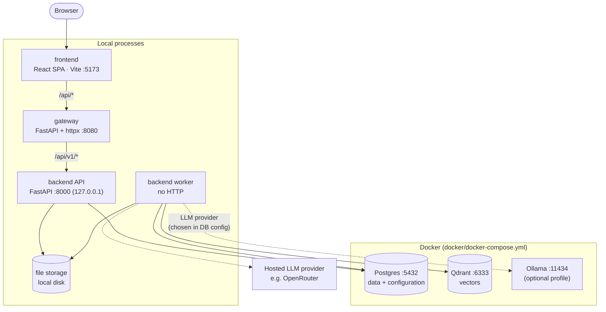
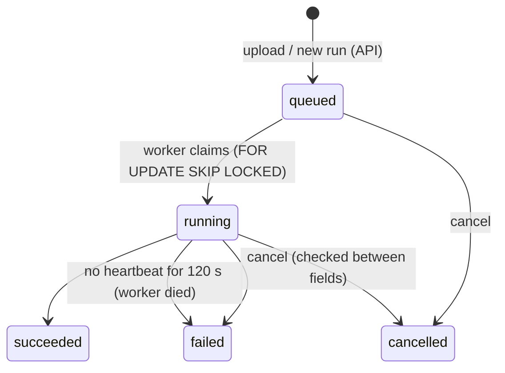
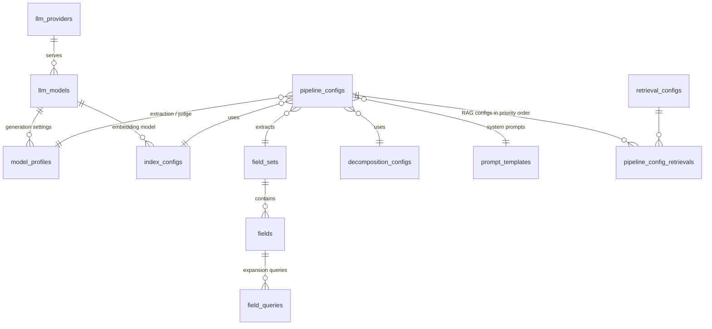

# Architecture

> Status: **Phase 0, agreed design.** Nothing below is implemented yet. Each part is built in its own phase
> (see [project-plan.md](project-plan.md)), and each phase may refine the details here after its plan is reviewed.

## 1. Purpose

ContractExtraction takes a contract PDF and returns a fixed set of data points (fields), each with:

- the extracted **value**
- the **evidence** it was based on (retrieved text chunks and their pages)
- a **verdict** from an LLM judge (`PASS` / `FAIL` / `ERROR` / `SKIPPED`)

It is a research tool, so every run must be **reproducible and comparable**. Each run records the settings it used and
every intermediate outcome (per search configuration and field), not only the best answer.

## 2. System overview



Postgres, Qdrant and Ollama are independent services that happen to be started by one compose file. Only Postgres is
"the database". Qdrant is the vector store. The LLM provider is pluggable: a local Ollama (Docker or native) or a hosted
API such as OpenRouter, which needs no container.

Plain-text version:

```
Browser ─► frontend (Vite :5173)
              │  /api/*
              ▼
           gateway (:8080) ── single entry point
              │  /api/v1/*
              ▼
           backend API (:8000, 127.0.0.1 only)          backend worker (no HTTP)
              │                                             │
              └──────────── Postgres (:5432) ◄──────────────┤  API ⇄ worker talk ONLY through Postgres
                            data + configuration            ├─► Qdrant  (:6333)   vectors
                                                            ├─► LLM provider      embeddings, extraction, judge
                                                            │     Ollama (:11434, local) or OpenRouter (hosted)
                                                            └─► file storage      PDFs, page JSON, images, logs

Docker (docker/docker-compose.yml): Postgres, Qdrant, Ollama (optional profile)
```

## 3. Components and boundaries

| Part | Owns | Talks to | Must not |
|---|---|---|---|
| **frontend** | UI: upload, document list, run progress, results with judge verdicts, page viewer | gateway only (relative `/api/...` URLs) | know the backend's address; hold business rules |
| **gateway** | routing `/api/*` → backend; request IDs; access logs; timeouts; upload size limit; CORS; aggregated `/health`; authentication (last phase) | backend API | contain business logic; access the database or storage |
| **backend API** | REST resources (documents, runs, results, pages, system); validation; enqueueing runs; reading results | Postgres, file storage | be reached by the browser directly; run pipeline work inside a request |
| **backend worker** | claims queued runs; heartbeats; cancellation; pipeline stages; writes results | Postgres, Qdrant, LLM provider, file storage | expose HTTP |
| **docker** | one compose file for Postgres, Qdrant and (optionally) Ollama; the Postgres image with `schema.sql` and `seed.sql` baked in | none | contain application code |

### Dependency rules

1. The browser → frontend → gateway → backend API chain is the only path in. Nothing skips a layer.
2. **The API and the worker never call each other.** The API writes a `queued` run row, and a worker claims it.
   Postgres is the queue ([ADR 0003](adr/0003-postgres-as-run-queue.md)).
3. Only the worker talks to the LLM provider and Qdrant. The API stays fast and never waits on an LLM.
4. `docker/schema.sql` is the single source of truth for the schema. The backend's ORM models must match it.
   There are no migrations: change the file, then recreate the database (`down -v`, then `up --build`).
5. Pipeline configuration (models, prompts, RAG settings, fields) lives in the database, not in env files.
   Env files hold only connection details and secrets.

## 4. Backend internals

The backend is one Python package with two entry points (API and worker) over shared layers:

```
backend/
  core/          settings, logging, errors
  domain/        plain models: Document, Page, Chunk, Field, SearchConfig, FieldResult, Verdict
  persistence/   SQLAlchemy models, repositories, file storage
  providers/     adapters behind interfaces: LLM and embedder (Ollama, OpenRouter / OpenAI-compatible), vector store (Qdrant, in-memory for tests)
  pipeline/      decomposition → chunking/indexing → retrieval → extraction → judge, orchestration
  worker/        claim loop, heartbeat, cancellation, stale-run recovery
  api/           FastAPI app, routers, request/response schemas
  cli/           local commands (run a PDF end to end, check services)
```

Layers depend only downward (`api`/`worker`/`cli` → `pipeline` → `domain`, `persistence`, `providers` → `core`).
Providers sit behind interfaces, so tests can run with fakes and no Docker.

## 5. Pipeline

| Stage | Input → output | Notes |
|---|---|---|
| **Decompose** | PDF → page Markdown + images | pymupdf4llm; optional OCR or hybrid for scanned PDFs; keep invisible OCR text; remove headers and footers only when a line repeats on 2+ pages and sits in the top or bottom zone |
| **Index** | pages → chunks → embeddings → vector index | chunks of 2000 chars with 300 overlap (configurable); **one index per document**; full chunk text stored in the payload; embedding dimension read from the model |
| **Retrieve** | field × search config → ranked chunks | query expansion (several queries per field), per-query top-k, score threshold, merge and deduplicate |
| **Extract** | field prompt + chunks → value | Ollama in JSON mode; explicit `num_ctx` so long prompts are not silently cut |
| **Judge** | value + evidence → verdict | separate LLM settings; can run in parallel with extraction |

Everything that shapes a run is **configuration stored in the database** (see §7.1), not code:
LLM providers and models, generation settings, system prompts, decomposition and chunking/embedding settings,
RAG configurations (`RAG01…RAG07`: top-k, threshold, expansion on or off), and fields with their prompts and expansion
queries. A **pipeline config** bundles them into a recipe. Every run stores the fully resolved recipe as a snapshot.

**Retrieval** (per field and RAG config):
1. Use the field's expansion queries when `query_expansion` is on, otherwise the field label.
2. Fetch `per_query_top` hits per query and keep those scoring at least `score_threshold`.
3. De-duplicate by chunk, keeping the best score and the query that found it.
4. Drop hits below `min_score` and keep the best `top_k`.

Query embeddings are computed once per run.

**Execution** goes through the RAG configs in priority order, and through each config's fields: retrieve → extraction LLM →
judge LLM. Each field result is committed on its own.
- **Reuse:** when a field gets exactly the same chunks again in the same run, it reuses the earlier answer and verdict
  instead of calling the models again (`reuse_calls`, on by default). Duplicate or nested RAG configs make this common on short documents.
- **Parallel judge:** `judge_parallel` (off by default) runs judge calls on a thread pool.
- **Self-grading:** the seeded judge uses the same model as extraction, so it grades its own answers. Use a different judge profile for an independent check.

## 6. Run lifecycle



- Workers claim the oldest queued run with `FOR UPDATE SKIP LOCKED`. The CLI's inline `run` queues and starts in one transaction,
  so a worker never takes it.
- A running run sends a **heartbeat** every 15 s from a background thread, because single LLM calls can take minutes.
  Each worker loop marks runs with a stale heartbeat as failed (one atomic `UPDATE`, using the database clock).
  If the original process was only slow, its heartbeat notices it lost the run and stops at the next field without overwriting the outcome.
- There are **no automatic retries** (`max_attempts` = 1). A failed run is simply run again.

- While `running`, the run reports a **stage** (`decomposing` → `indexing` → `extracting`) and **progress** (done/total).
- At most one active (queued or running) run per document.
- Each run stores the **options** chosen by the caller and a **snapshot of the resolved pipeline config**, narrowed by those options.
  The executor runs **from the snapshot**, so later config edits never change what a queued or past run does.
- Failures are contained:
  - a provider error on one field becomes an `error` result, and the run continues
  - a failed stage (decompose or index) fails the run, with the reason in `runs.error` and `run_events`
- The frontend polls the run (default every 2 s). Push updates (SSE) can come later through the gateway.

## 7. Data model

The full definition is in [`docker/schema.sql`](../docker/schema.sql): 26 tables and 2 views in four groups. The default
configuration is in [`docker/seed.sql`](../docker/seed.sql).

### 7.1 Model & RAG configuration



| Table | Holds |
|---|---|
| `llm_providers` | Ollama, OpenRouter or any OpenAI-compatible endpoint: base URL, and the **name** of the env var with the API key (no secrets in the DB) |
| `llm_models` | chat, embedding or vision models per provider: context window, embedding dimension, token prices |
| `model_profiles` | a model plus generation settings (temperature, top_p, top_k, num_ctx, JSON mode, timeout) |
| `prompt_templates` | versioned system prompts (extraction, judge, caption); one active version per name |
| `decomposition_configs` | PDF → text settings (method, format, OCR, header/footer removal, optional captioning profile) |
| `index_configs` | chunk size and overlap, embedding model, vector store, distance metric |
| `retrieval_configs` | RAG settings: top-k, score threshold, query expansion, per-query top, minimum score |
| `field_sets`, `fields`, `field_queries` | versioned field sets; each field has a key, label, value type, user prompt and expansion queries |
| `pipeline_configs`, `pipeline_config_retrievals` | the recipe a run executes, with its RAG configs in priority order; one is the default |

### 7.2 Documents & artifacts

```
documents 1──* decompositions 1──* pages 1──* page_images
                    └──* vector_indexes 1──* chunks
```

- **documents**: an uploaded PDF (code `DOC001`…, sha256 unique, so the same file is stored once; tags; metadata).
- **decompositions**: one per attempt, with its config snapshot. Never overwritten.
- **pages**: text, header and footer, size, metadata, and a generated full-text search column.
- **vector_indexes**: one collection per decomposition × index config, reused by later runs.
- **chunks**: chunk text with page and character ranges. `chunks.id` is the vector-store point id, so evidence can be traced exactly.

### 7.3 Runs & results

```
experiments 1──* runs 1──* run_events
                   └──* field_results 1──* retrieval_hits *──1 chunks
                              ├──* llm_calls
                              └──* judgements
```

- **runs**: the job queue (state, stage, progress, attempts, heartbeat), the pipeline config, and a `config_snapshot` with the resolved recipe.
- **run_events**: the run's timeline and log.
- **field_results**: one outcome per run × RAG config × field (`extracted` / `not_found` / `error`).
- **retrieval_hits**: the chunks used as evidence, with score and matching query.
- **llm_calls**: every LLM call, with prompts, response, token usage, latency and cost.
- **judgements**: verdicts (`PASS` / `FAIL` / `ERROR` / `SKIPPED`) plus an issue type. A result can be judged again, and the latest judgement counts.

### 7.4 Evaluation

- **ground_truth**: human-labelled expected values per document and field.
- **`v_best_values`** (view): the best value per run and field (a PASS from the highest-priority RAG config, otherwise the first extracted value).
- **`v_run_evaluation`** (view): best values next to the ground truth, with a simple exact-match flag.

### Rules

- Configuration referenced by runs or results can't be deleted. Deleting a document deletes everything derived from it.
- Large artifacts (PDF, page JSON, images, logs) live in **file storage**, and rows store their paths.
- Status columns are text with named CHECK constraints. `updated_at` is maintained by triggers.

### File storage layout

```
storage/
  <document code>/
    source/<file>.pdf
    decompositions/<decomposition id>/{json,images}/
    logs/<run id>.log
    exports/
```

Storage sits behind an interface, so local disk can later be swapped for MinIO or S3.

## 8. API surface (backend, behind the gateway)

All routes are under `/api/v1`. The backend's OpenAPI document is the **contract**: the frontend generates its TypeScript
types from it.

| Resource | Endpoints (planned) |
|---|---|
| system | `GET /health`, `GET /config` (search configs, fields) |
| documents | `POST /documents` (upload → queues a full run), `GET /documents`, `GET /documents/{id}`, `GET /documents/{id}/pages`, `GET /documents/{id}/images/{name}`, `POST /documents/{id}/runs` |
| runs | `GET /runs/{id}`, `POST /runs/{id}/cancel`, `GET /runs/{id}/results`, `GET /runs/{id}/results/{resultId}`, `GET /runs/{id}/log` |

Errors use one JSON shape: `{"detail": "..."}` with 400, 404, 409, 413 or 422.

## 9. Gateway

- Streams requests and responses with httpx, so large PDF uploads are never fully buffered.
- Adds or propagates `X-Request-ID` on every request and logs it in gateway and backend logs.
- Enforces the upload size limit and upstream timeouts. Returns `502`/`504` with the same `{"detail"}` error shape.
- Owns CORS. The backend doesn't configure CORS at all.
- `GET /health` reports the gateway itself plus the backend's health. The backend in turn reports Postgres, Qdrant and Ollama.
- **Later:** authentication (last phase), rate limiting, optionally serving the built frontend (`frontend/dist`).

See [ADR 0002](adr/0002-custom-gateway.md).

## 10. Configuration conventions

- **Pipeline configuration lives in the database** (§7.1). Env files only hold connection details and secrets such as `OPENROUTER_API_KEY`.
- Each part reads its env config only from **its own folder** (`backend/config/`, `gateway/config/`, `frontend/`, `docker/`).
- Layered `.env` files, later ones overriding earlier ones: `.env` → `.env.<APP_ENV>` → `.env.local` → `.env.<APP_ENV>.local`.
  Real environment variables override all files. `*.local` files are never committed.
- Nested keys use `__`, e.g. `EXTRACTION_LLM__MODEL=llama3.1:8b`, `UPSTREAM__BACKEND_URL=http://127.0.0.1:8000`.
- The frontend only sees `VITE_*` variables, and never secrets.

### Ports

| Service | Port | Bound to |
|---|---|---|
| frontend (Vite dev) | 5173 | localhost |
| gateway | 8080 | localhost |
| backend API | 8000 | 127.0.0.1 (reached only through the gateway) |
| Postgres | 5432 (`POSTGRES_PORT`) | Docker, published to 127.0.0.1 |
| Qdrant | 6333 (`QDRANT_PORT`) | Docker, published to 127.0.0.1 |
| Ollama (native) | 11434 | `Ollama.app` (default on macOS) |
| Ollama (Docker) | 11435 (`OLLAMA_PORT`) | Docker profile `ollama`, published to 127.0.0.1 |

## 11. Runtime (local)

- **LLMs:** native Ollama (`Ollama.app`, Apple GPU) on port 11434 is the default on macOS. In a measured run it was about 8× faster
  than Ollama in Docker, which is CPU-only on macOS. The Docker `ollama` profile runs on port 11435, so both can run at once.
  The `ollama-local` provider's `base_url` picks one: `contract-extraction providers set ollama-local --base-url …`.
  Runs record the URL they used in their snapshot.
- **Docker:** `docker/docker-compose.yml` starts Postgres and Qdrant, plus Ollama with `--profile ollama`.
  The Postgres image is built from `docker/Dockerfile` with `schema.sql` and `seed.sql` baked in. They run on an empty volume,
  so `down -v`, then `up --build`, gives a clean database.
- **Local processes:** backend API, one or more backend workers, gateway and frontend. Phase 8 adds `scripts/dev.sh`
  to start them all with one command.

See [ADR 0004](adr/0004-local-processes-docker-infra.md).

## 12. Technology (proposed, confirmed in each phase's plan)

| Part | Stack |
|---|---|
| backend | Python 3.12, uv, FastAPI, Pydantic v2 + pydantic-settings, SQLAlchemy 2, psycopg 3, httpx, pymupdf / pymupdf4llm, pytest |
| gateway | Python 3.12, uv, FastAPI, httpx (streaming), pytest |
| docker | Postgres 16 (plain SQL schema, no migrations), Qdrant, Ollama, Docker Compose |
| LLM providers | Ollama (local) or OpenRouter / OpenAI-compatible APIs (hosted) |
| frontend | React 18, TypeScript, Vite, TanStack Query, React Router, Vitest + Testing Library |

## 13. Lessons carried over from the prototype

The prototype (`DocumentExtraction`, kept as a read-only backup) showed what to keep. It isn't ported; we only reuse the ideas:

- One vector index **per document**. A shared index made a new PDF search the previous PDF's vectors.
- Store the **full chunk text** in the vector payload. Truncated chunks fed the LLM half the evidence.
- Set Ollama's **context window explicitly**. The default of 4096 tokens silently truncates long prompts.
- Ask the LLM for **JSON mode**, but still parse answers wrapped in code fences or prose.
- Header and footer removal must require repetition on **2+ pages** and stay within the top or bottom zone.
- Record a **settings snapshot** with every run, so results stay comparable across experiments.
- Keep each decomposition in its **own folder**, so re-processing never breaks earlier rows.

## 14. Out of scope (for now)

- Authentication and authorization (last phase, in the gateway).
- Multi-user and multi-tenant features.
- Cloud deployment, Kubernetes, containerizing the app services.
- Object storage (the storage interface keeps this possible).
