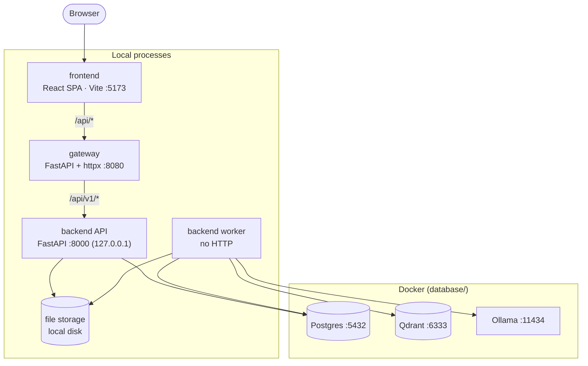
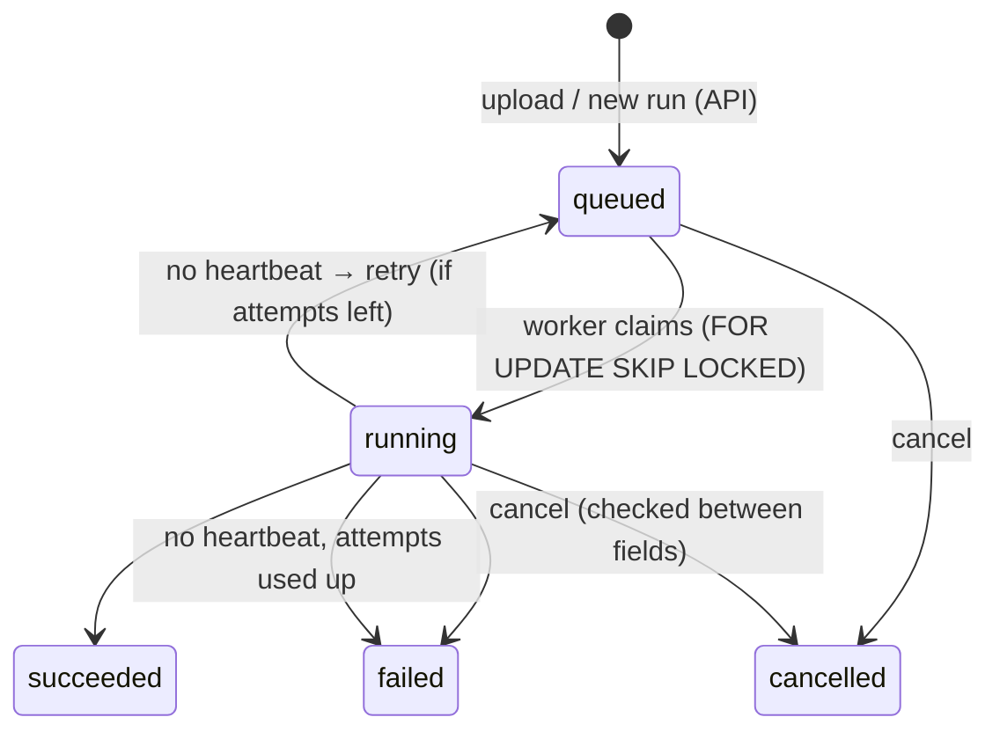

# Architecture

> Status: **Phase 0, agreed design.** Nothing below is implemented yet. Each part is built in its own phase
> (see [project-plan.md](project-plan.md)), and each phase may refine the details here after its plan is reviewed.

## 1. Purpose

ContractExtraction takes a contract PDF and returns a fixed set of data points (fields), each with:

- the extracted **value**
- the **evidence** it was based on (retrieved text chunks and their pages)
- a **verdict** from an LLM judge (`PASS` / `FAIL` / `ERROR` / `SKIPPED`)

It is a research tool, so every run must be **reproducible and comparable**. Each run records the settings it used and
every intermediate outcome (per search configuration and field), not only the best answer.

## 2. System overview



Plain-text version:

```
Browser ─► frontend (Vite :5173)
              │  /api/*
              ▼
           gateway (:8080) ── single entry point
              │  /api/v1/*
              ▼
           backend API (:8000, 127.0.0.1 only)          backend worker (no HTTP)
              │                                             │
              └──────────── Postgres (:5432) ◄──────────────┤  API ⇄ worker talk ONLY through Postgres
                                                            ├─► Qdrant  (:6333)   vectors
                                                            ├─► Ollama  (:11434)  embeddings, extraction LLM, judge LLM
                                                            └─► file storage      PDFs, page JSON, images, logs
```

## 3. Components and boundaries

| Part | Owns | Talks to | Must not |
|---|---|---|---|
| **frontend** | UI: upload, document list, run progress, results with judge verdicts, page viewer | gateway only (relative `/api/...` URLs) | know the backend's address; hold business rules |
| **gateway** | routing `/api/*` → backend; request IDs; access logs; timeouts; upload size limit; CORS; aggregated `/health`; authentication (last phase) | backend API | contain business logic; access the database or storage |
| **backend API** | REST resources (documents, runs, results, pages, system); validation; enqueueing runs; reading results | Postgres, file storage | be reached by the browser directly; run pipeline work inside a request |
| **backend worker** | claims queued runs; heartbeats; cancellation; pipeline stages; writes results | Postgres, Qdrant, Ollama, file storage | expose HTTP |
| **database** | Docker Compose for Postgres, Qdrant and Ollama; env examples; init scripts (including the test database); schema migrations; seed and backup scripts | none | contain application code |

### Dependency rules

1. The browser → frontend → gateway → backend API chain is the only path in. Nothing skips a layer.
2. **The API and the worker never call each other.** The API writes a `queued` run row, and a worker claims it.
   Postgres is the queue ([ADR 0003](adr/0003-postgres-as-run-queue.md)).
3. Only the worker talks to Ollama and Qdrant. The API stays fast and never waits on an LLM.
4. Schema changes live only in `database/` migrations. The backend's ORM models must match them.

## 4. Backend internals

The backend is one Python package with two entry points (API and worker) over shared layers:

```
backend/
  core/          settings, logging, errors
  domain/        plain models: Document, Page, Chunk, Field, SearchConfig, FieldResult, Verdict
  persistence/   SQLAlchemy models, repositories, file storage
  providers/     adapters behind interfaces: LLM (Ollama), embedder, vector store (Qdrant, in-memory for tests)
  pipeline/      decomposition → chunking/indexing → retrieval → extraction → judge, orchestration
  worker/        claim loop, heartbeat, cancellation, stale-run recovery
  api/           FastAPI app, routers, request/response schemas
  cli/           local commands (run a PDF end to end, check services)
```

Layers depend only downward (`api`/`worker`/`cli` → `pipeline` → `domain`, `persistence`, `providers` → `core`).
Providers sit behind interfaces, so tests can run with fakes and no Docker.

## 5. Pipeline

| Stage | Input → output | Notes |
|---|---|---|
| **Decompose** | PDF → page Markdown + images | pymupdf4llm; optional OCR or hybrid for scanned PDFs; keep invisible OCR text; remove headers and footers only when a line repeats on 2+ pages and sits in the top or bottom zone |
| **Index** | pages → chunks → embeddings → vector index | chunks of 2000 chars with 300 overlap (configurable); **one index per document**; full chunk text stored in the payload; embedding dimension read from the model |
| **Retrieve** | field × search config → ranked chunks | query expansion (several queries per field), per-query top-k, score threshold, merge and deduplicate |
| **Extract** | field prompt + chunks → value | Ollama in JSON mode; explicit `num_ctx` so long prompts are not silently cut |
| **Judge** | value + evidence → verdict | separate LLM settings; can run in parallel with extraction |

Fields and their prompts and expansion queries are **configuration** (a JSON template file), not code.
Search configurations (e.g. `RAG01…RAG07`: top-k, threshold, expansion on or off) are configuration too.

## 6. Run lifecycle



- While `running`, the run reports a **stage** (`decomposing` → `indexing` → `extracting`) and **progress** (done/total).
- At most one active (queued or running) run per document.
- Each run stores the **options** chosen by the caller and a **snapshot of the effective non-secret settings**.
- The frontend polls the run (default every 2 s). Push updates (SSE) can come later through the gateway.

## 7. Data model (conceptual)

```
documents 1──* decompositions 1──* pages
    │               └──* vector_indexes
    └──* runs ─→ decomposition, vector_index (set as stages complete)
            └──* field_results 1──* retrieval_hits
```

- **documents**: uploaded PDF (sha256, size, page count, storage path, short code like `DOC001`).
- **decompositions**: one per decomposition attempt (method, format, options, duration). Never overwritten.
- **pages**: text, header and footer, metadata per page.
- **vector_indexes**: backend, index name, embedder model, dimension, chunk count, chunking options.
- **runs**: kind (`full` / `decompose` / `extract`), state, stage, progress, options, settings snapshot, worker, heartbeat, error.
- **field_results**: per run × search config × field: value, raw answer, context, timings, judge verdict.
- **retrieval_hits**: rank, chunk, score and page for each field result.

Large artifacts (PDF, page JSON, images, logs) live in **file storage**, and rows store their paths. Status columns are text
with CHECK constraints, so adding a value doesn't need an enum migration.

### File storage layout

```
storage/
  <document code>/
    source/<file>.pdf
    decompositions/<decomposition id>/{json,images}/
    logs/<run id>.log
    exports/
```

Storage sits behind an interface, so local disk can later be swapped for MinIO or S3.

## 8. API surface (backend, behind the gateway)

All routes are under `/api/v1`. The backend's OpenAPI document is the **contract**: the frontend generates its TypeScript
types from it.

| Resource | Endpoints (planned) |
|---|---|
| system | `GET /health`, `GET /config` (search configs, fields) |
| documents | `POST /documents` (upload → queues a full run), `GET /documents`, `GET /documents/{id}`, `GET /documents/{id}/pages`, `GET /documents/{id}/images/{name}`, `POST /documents/{id}/runs` |
| runs | `GET /runs/{id}`, `POST /runs/{id}/cancel`, `GET /runs/{id}/results`, `GET /runs/{id}/results/{resultId}`, `GET /runs/{id}/log` |

Errors use one JSON shape: `{"detail": "..."}` with 400, 404, 409, 413 or 422.

## 9. Gateway

- Streams requests and responses with httpx, so large PDF uploads are never fully buffered.
- Adds or propagates `X-Request-ID` on every request and logs it in gateway and backend logs.
- Enforces the upload size limit and upstream timeouts. Returns `502`/`504` with the same `{"detail"}` error shape.
- Owns CORS. The backend doesn't configure CORS at all.
- `GET /health` reports the gateway itself plus the backend's health. The backend in turn reports Postgres, Qdrant and Ollama.
- **Later:** authentication (last phase), rate limiting, optionally serving the built frontend (`frontend/dist`).

See [ADR 0002](adr/0002-custom-gateway.md).

## 10. Configuration conventions

- Each part reads config only from **its own folder** (`backend/config/`, `gateway/config/`, `frontend/`, `database/`).
- Layered `.env` files, later ones overriding earlier ones: `.env` → `.env.<APP_ENV>` → `.env.local` → `.env.<APP_ENV>.local`.
  Real environment variables override all files. `*.local` files are never committed.
- Nested keys use `__`, e.g. `EXTRACTION_LLM__MODEL=llama3.1:8b`, `UPSTREAM__BACKEND_URL=http://127.0.0.1:8000`.
- Lists that don't fit env vars (search configurations, field templates) live in JSON files that the env settings point to.
- The frontend only sees `VITE_*` variables, and never secrets.

### Ports

| Service | Port | Bound to |
|---|---|---|
| frontend (Vite dev) | 5173 | localhost |
| gateway | 8080 | localhost |
| backend API | 8000 | 127.0.0.1 (reached only through the gateway) |
| Postgres | 5432 | Docker, published to localhost |
| Qdrant | 6333 | Docker, published to localhost |
| Ollama | 11434 | Docker, published to localhost (an existing local Ollama can be reused) |

## 11. Runtime (local)

- **Docker:** Postgres, Qdrant and Ollama, started by `scripts/infra-up.sh` from `database/docker-compose.yml`.
  The script reuses a Qdrant or Ollama that is already running and pulls the required Ollama models.
- **Local processes:** backend API, one or more backend workers, gateway and frontend. Phase 8 adds `scripts/dev.sh`
  to start them all with one command.

See [ADR 0004](adr/0004-local-processes-docker-infra.md).

## 12. Technology (proposed, confirmed in each phase's plan)

| Part | Stack |
|---|---|
| backend | Python 3.12, uv, FastAPI, Pydantic v2 + pydantic-settings, SQLAlchemy 2, psycopg 3, httpx, pymupdf / pymupdf4llm, pytest |
| gateway | Python 3.12, uv, FastAPI, httpx (streaming), pytest |
| database | Postgres 16, Qdrant, Ollama (Docker Compose), Alembic migrations |
| frontend | React 18, TypeScript, Vite, TanStack Query, React Router, Vitest + Testing Library |

## 13. Lessons carried over from the prototype

The prototype (`DocumentExtraction`, kept as a read-only backup) showed what to keep. It isn't ported; we only reuse the ideas:

- One vector index **per document**. A shared index made a new PDF search the previous PDF's vectors.
- Store the **full chunk text** in the vector payload. Truncated chunks fed the LLM half the evidence.
- Set Ollama's **context window explicitly**. The default of 4096 tokens silently truncates long prompts.
- Ask the LLM for **JSON mode**, but still parse answers wrapped in code fences or prose.
- Header and footer removal must require repetition on **2+ pages** and stay within the top or bottom zone.
- Record a **settings snapshot** with every run, so results stay comparable across experiments.
- Keep each decomposition in its **own folder**, so re-processing never breaks earlier rows.

## 14. Out of scope (for now)

- Authentication and authorization (last phase, in the gateway).
- Multi-user and multi-tenant features.
- Cloud deployment, Kubernetes, containerizing the app services.
- Object storage (the storage interface keeps this possible).
