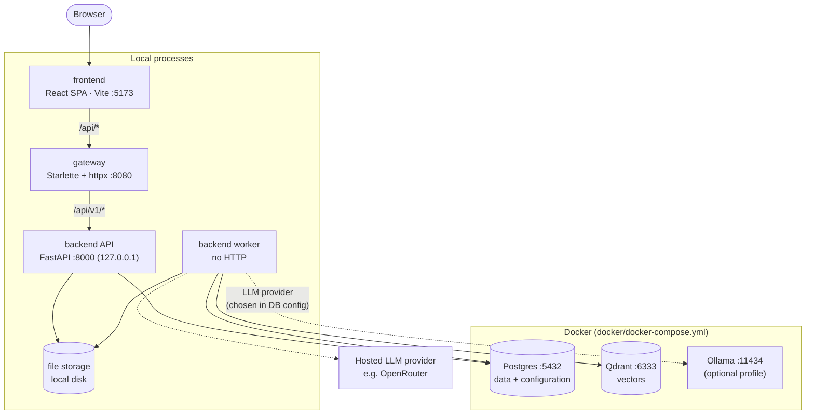
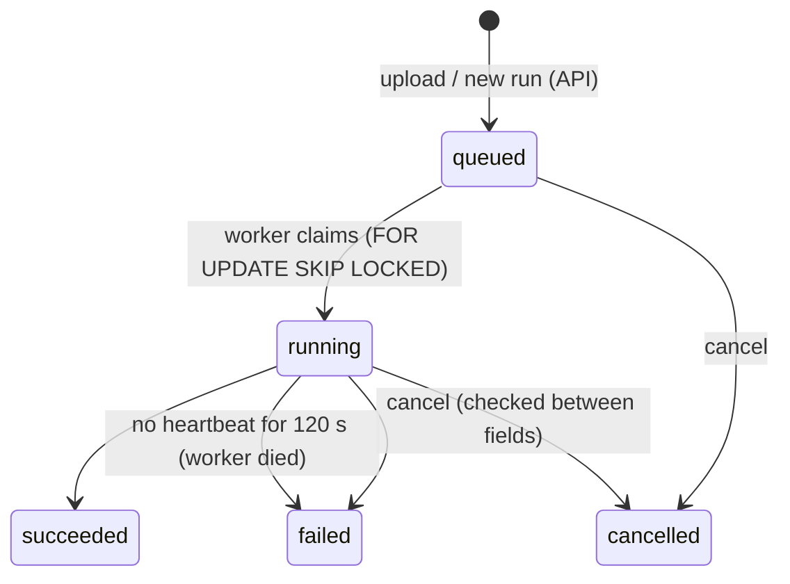
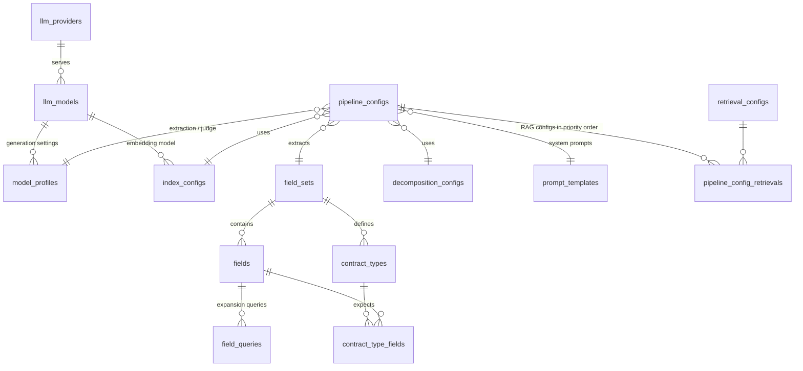

# Architecture

> Status: **implemented through Phase 8.** Each phase updates this document with what it built and decided
> (see [project-plan.md](project-plan.md)).

## 1. Purpose

ContractExtraction takes a contract PDF and returns a fixed set of data points (fields), each with:

- the extracted **value**
- the **evidence** it was based on (retrieved text chunks and their pages)
- a **verdict** from an LLM judge (`PASS` / `FAIL` / `ERROR` / `SKIPPED`)

It is a research tool, so every run must be **reproducible and comparable**. Each run records the settings it used and
every intermediate outcome (per search configuration and field), not only the best answer.

## 2. System overview



Postgres, Qdrant and Ollama are independent services that happen to be started by one compose file. Only Postgres is
"the database". Qdrant is the vector store. The LLM provider is pluggable: a local Ollama (Docker or native) or a hosted
API such as OpenRouter, which needs no container.

Plain-text version:

```
Browser ─► frontend (Vite :5173)
              │  /api/*
              ▼
           gateway (:8080) ── single entry point
              │  /api/v1/*
              ▼
           backend API (:8000, 127.0.0.1 only)          backend worker (no HTTP)
              │                                             │
              └──────────── Postgres (:5432) ◄──────────────┤  API ⇄ worker talk ONLY through Postgres
                            data + configuration            ├─► Qdrant  (:6333)   vectors
                                                            ├─► LLM provider      embeddings, extraction, judge
                                                            │     Ollama (:11434, local) or OpenRouter (hosted)
                                                            └─► file storage      PDFs, page JSON, images, logs

Docker (docker/docker-compose.yml): Postgres, Qdrant, Ollama (optional profile)
```

## 3. Components and boundaries

| Part | Owns | Talks to | Must not |
|---|---|---|---|
| **frontend** | UI: upload, document list, run progress, results with judge verdicts, page viewer | gateway only (relative `/api/...` URLs) | know the backend's address; hold business rules |
| **gateway** | routing `/api/*` → backend; request IDs; access logs; timeouts; upload size limit; CORS; aggregated `/health`; authentication (last phase) | backend API | contain business logic; access the database or storage |
| **backend API** | REST resources (documents, runs, results, pages, system); validation; enqueueing runs; reading results | Postgres, file storage | be reached by the browser directly; run pipeline work inside a request |
| **backend worker** | claims queued runs; heartbeats; cancellation; pipeline stages; writes results | Postgres, Qdrant, LLM provider, file storage | expose HTTP |
| **docker** | one compose file for Postgres, Qdrant and (optionally) Ollama; the Postgres image with `schema.sql`, `seed.sql`, `seed_catalogue.sql` and `seed_presets.sql` baked in | none | contain application code |

### Dependency rules

1. The browser → frontend → gateway → backend API chain is the only path in. Nothing skips a layer.
2. **The API and the worker never call each other.** The API writes a `queued` run row, and a worker claims it.
   Postgres is the queue ([ADR 0003](adr/0003-postgres-as-run-queue.md)).
3. Only the worker talks to the LLM provider and Qdrant. The API stays fast and never waits on an LLM.
4. `docker/schema.sql` is the single source of truth for the schema. The backend's ORM models must match it.
   There are no migrations: change the file, then recreate the database (`down -v`, then `up --build`).
5. Pipeline configuration (models, prompts, RAG settings, fields) lives in the database, not in env files.
   Env files hold only connection details and secrets.

## 4. Backend internals

The backend is one Python package, `contract_extraction`, with two entry points (API and worker) over shared layers:

```
backend/src/contract_extraction/
  core/           settings, logging, errors
  domain/         enums mirroring the schema's CHECK values; the resolved pipeline config (frozen, snapshot())
  persistence/    SQLAlchemy models mirroring schema.sql, repositories
  providers/      adapters behind interfaces: chat and embedding (Ollama, OpenAI-compatible), vector store (Qdrant, in-memory)
  decomposition/  converters/ (format registry and detection; one converter per format, e.g. PDF via pymupdf / OCR / hybrid),
                  header and footer removal, the decomposition stage
  indexing/       chunking with exact offsets, embedding and upserting
  extraction/     retrieval, prompts, answer parsing, judge
  pipeline/       run options and the executor (stages, progress, events, reuse)
  api/            FastAPI app, routes/, request/response schemas, problem details
  ingestion.py    register → decompose → index, reusing earlier work
  storage.py      local file storage
  health.py       liveness and readiness, shared by the API and `check`
  worker.py       claim loop, heartbeat, cancellation, stale-run recovery
  cli.py          contract-extraction check | ingest | run | worker | status | cancel | api | openapi | providers
```

Layers depend only downward (`api` / `worker` / `cli` → `pipeline` → `extraction`, `indexing`, `decomposition` →
`domain`, `persistence`, `providers` → `core`).
Providers sit behind interfaces, so tests can run with fakes and no Docker.

## 5. Pipeline

| Stage | Input → output | Notes |
|---|---|---|
| **Decompose** | source file → page Markdown + images | the document's format picks its converter (*Source formats* below); PDFs: pymupdf4llm, optional OCR or hybrid for scans, keep invisible OCR text; remove headers and footers only when a line repeats on 2+ pages and sits in the top or bottom zone (not for pages split by length) |
| **Index** | pages → chunks → embeddings + keyword vectors → vector index | chunks of 2000 chars with 300 overlap (configurable); **one index per document**; each chunk's *search text* (Markdown removed, tables as rows, its section heading in front) is embedded and turned into a BM25 keyword vector; full chunk text stored in the payload; embedding dimension read from the model |
| **Retrieve** | field × search config → ranked chunks | query expansion (several queries per field), per-query top-k, score threshold, optional keyword search fused with the dense ranking, optional anchor chunks, merge and deduplicate |
| **Extract** | field prompt + chunks → value | Ollama in JSON mode; explicit `num_ctx` so long prompts are not silently cut |
| **Judge** | value + evidence → verdict | separate LLM settings; can run in parallel with extraction |

Everything that shapes a run is **configuration stored in the database** (see §7.1), not code:
LLM providers and models, generation settings, system prompts, decomposition and chunking/embedding settings,
RAG configurations (`RAG01…RAG07`: top-k, threshold, expansion, keyword search and anchor chunks on or off), and fields with their prompts and expansion
queries. A **pipeline config** bundles them into a recipe. Every run stores the fully resolved recipe as a snapshot.

**Source formats.** `decomposition/converters/` holds one converter per format; its `REGISTRY` is the only list of
supported formats. Upload validation, the error message, `GET /config/formats` and the frontend's file picker all come from it.
- **Detection** happens at upload, not from the client's content type. Binary signatures win (e.g. `%PDF-`). Among text formats the extension
  decides. The format and mime type are stored on the document, and an unsupported file is rejected (422) and not kept.
- **Converters** return pages, page sizes (for paged sources), the converter that ran (stored as `decompositions.converter`,
  e.g. `pdf:pymupdf`) and how pages were made: `source` (real pages), `marker` (text split at page-break markers) or
  `size` (split by length). Images they extract go to the decomposition's `images/` folder.
- **Config.** A decomposition config's `method` applies to PDFs.
- **Downstream.** Everything after decomposition works on page rows and doesn't know the format.
- **Viewer.** The page viewer shows the original next to the text: PDFs at the same page; images (except TIFF, which browsers
  don't render) as an image; everything else as a download link.
- **Supported** so far:
  - **PDF**: pdf-converter.
  - **HTML** (`.htm`, `.html`):
    - Sanitised with BeautifulSoup and lxml.
    - Page breaks are CSS `page-break-*` / `break-*` and EDGAR `<PAGE>`.
    - Layout tables become paragraphs; web-page navigation and remote images are dropped.
    - Output is Markdown via markdownify, or clean HTML.
  - **Plain text** (`.txt`, or text without a known extension):
    - Page breaks are EDGAR `<PAGE>` and form feeds.
    - Indentation is removed, and line-start `#` / `>` are escaped.
  - **Images** (PNG, JPEG, TIFF incl. multi-page, GIF, BMP, WEBP):
    - Pillow writes one PDF page per frame, turned upright from EXIF and sized for the config's OCR DPI.
    - The PDF converter then always uses OCR. The PDF is kept as the decomposition's `source.pdf`.
    - Converter: `image:ocr`.
  - **Word** (`.docx`):
    - mammoth turns it into HTML, which then goes through the HTML converter.
    - Pages break where Word last laid them out (`w:lastRenderedPageBreak`) and at explicit page breaks.
    - Embedded images are kept.
    - At upload, the file must be a zip containing `word/document.xml` that expands to at most 512 MB.
  - EDGAR's SGML wrapper is removed in both HTML and plain text.
  - Text without page breaks is split at paragraphs near `options.page_chars` (default 3000).

**Fields and contract types** come from [`contract_types_and_fields.md`](contract_types_and_fields.md), the source of truth:
18 contract types (NDA, MSA, SOW, SaaS, …) plus a fallback type **Other**, and 286 fields. Each field has a type (e.g.
`duration`, `object: rate, cap`), turned into a JSON Schema, a priority (P1 = direct financial, time or exit exposure …
P3 = informational) and a description. Shared groups (Core, Commercial, Risk & Liability, Restrictive Covenants, IP & Data)
are defined once; each type adds its own fields. `contract-extraction gen-catalogue` parses the document and writes
`docker/seed_catalogue.sql`. Catalogue fields have no hand-written prompt: the extraction prompt is built from the field's
description and value type.

**Classification** (before extraction, stage `classifying`): one LLM call reads the document's first pages
(`classification_pages`, from the chunk rows) and names the contract type(s), each with a confidence and a quote. Types
reaching `classification_min_confidence` are used, several at once when the document holds several agreements; none, or
classification off, means the fallback type. A run can name its types instead (`contract_types`), or its exact fields
(`fields`). The run then extracts the union of the types' fields down to the pipeline's `min_priority`, P1 first. Every
decision is stored in `run_classifications` (source `classifier`, `override` or `fallback`), including proposals below
the threshold. Extracted values are checked against the field's JSON Schema (types and enums; formats are not enforced).

**Retrieval** (per field and RAG config):
1. Use the field's expansion queries when `query_expansion` is on, otherwise the field label.
2. Fetch `per_query_top` dense (embedding) hits per query and keep those scoring at least `score_threshold` and `min_score`.
3. With `keyword_search`, also fetch `per_query_top` keyword (BM25) hits per query. Words are stemmed and stop words
   dropped; terms rare in the document weigh most (Qdrant computes the IDF per collection) and heading terms count 3×.
4. De-duplicate by chunk, keeping the best scores and the query that found it. Rank by dense score, or, with keyword
   search, by reciprocal rank fusion of all the dense and keyword lists (Σ 1/(60 + rank)). Keep the best `top_k`.
5. With `anchor_chunks`, a field with an `anchor` (cover-page fields such as `parties` start, signature-page fields
   such as `signatories` end; listed in the catalogue document) also gets the document's first and/or last
   `anchor_chunks` chunks, beyond `top_k`. Similarity search alone misses these: a cover page often ranks below clauses
   that merely mention the parties. Keep `top_k + 2 × anchor_chunks` chunks within the extraction model's `num_ctx`.

Each hit records how it was found (`dense`, `keyword`, `both` or `anchor`). Query embeddings are computed once per run.

**Execution** goes through the RAG configs in priority order, and through each config's fields: retrieve → extraction LLM →
judge LLM. Each field result is committed on its own.
- **Reuse:** when a field gets exactly the same chunks again in the same run, it reuses the earlier answer and verdict
  instead of calling the models again (`reuse_calls`, on by default). Duplicate or nested RAG configs make this common on short documents.
- **Parallel judge:** `judge_parallel` (off by default) runs judge calls on a thread pool.
- **Self-grading:** the seeded judge uses the same model as extraction, so it grades its own answers. Use a different judge profile for an independent check.

## 6. Run lifecycle



- Workers claim the oldest queued run with `FOR UPDATE SKIP LOCKED`. The CLI's inline `run` queues and starts in one transaction,
  so a worker never takes it.
- A running run sends a **heartbeat** every 15 s from a background thread, because single LLM calls can take minutes.
  Each worker loop marks runs with a stale heartbeat as failed (one atomic `UPDATE`, using the database clock).
  If the original process was only slow, its heartbeat notices it lost the run and stops at the next field without overwriting the outcome.
- There are **no automatic retries** (`max_attempts` = 1). A failed run is simply run again.

- While `running`, the run reports a **stage** (`decomposing` → `indexing` → `classifying` → `extracting`) and **progress** (done/total).
- At most one active (queued or running) run per document.
- Each run stores the **options** chosen by the caller and a **snapshot of the resolved pipeline config**, narrowed by those options.
  The executor runs **from the snapshot**, so later config edits never change what a queued or past run does.
- Failures are contained:
  - a provider error on one field becomes an `error` result, and the run continues
  - a failed stage (decompose or index) fails the run, with the reason in `runs.error` and `run_events`
- The frontend polls the run (default every 2 s). Push updates (SSE) can come later through the gateway.

## 7. Data model

The full definition is in [`docker/schema.sql`](../docker/schema.sql): 31 tables and 2 views in four groups. The default
configuration is in [`docker/seed.sql`](../docker/seed.sql); the fields and contract types in the generated
[`docker/seed_catalogue.sql`](../docker/seed_catalogue.sql). [`docker/seed_presets.sql`](../docker/seed_presets.sql) adds
low-cost OpenRouter models and profiles, the hybrid RAG08-RAG11 configs and ready-made pipelines (`local-*`, `or-*`); it
skips existing rows, so it can also be applied to a running database.

### 7.1 Model & RAG configuration



| Table | Holds |
|---|---|
| `llm_providers` | Ollama, OpenRouter or any OpenAI-compatible endpoint: base URL, and the **name** of the env var with the API key (no secrets in the DB) |
| `llm_models` | chat, embedding or vision models per provider: context window, embedding dimension, token prices |
| `model_profiles` | a model plus generation settings (temperature, top_p, top_k, num_ctx, JSON mode, timeout) |
| `prompt_templates` | versioned system prompts (extraction, judge, caption); one active version per name |
| `decomposition_configs` | file → text settings (PDF method, text format, OCR, header/footer removal, optional captioning profile, `options` such as a page range) |
| `index_configs` | chunk size and overlap, embedding model, vector store, distance metric |
| `retrieval_configs` | RAG settings: top-k, score threshold, query expansion, per-query top, minimum score, keyword search, anchor chunks |
| `field_sets`, `fields`, `field_queries` | versioned field sets; each field has a key, label, value type, catalogue type and JSON Schema, priority, optional hand-written prompt, and expansion queries |
| `contract_types`, `contract_type_fields` | the contract types of a field set (one is the fallback) and the fields each expects, with their group and per-type priority |
| `pipeline_configs`, `pipeline_config_retrievals` | the recipe a run executes, with its RAG configs in priority order; one is the default |

**Editing** (API `/config/*` and the UI's Configuration page). Runs execute from their snapshot, so edits only affect runs
queued afterwards. The rules (in `ConfigWriter`):

- Edited in place: pipelines, RAG configs, model profiles, fields and their expansion queries, a provider's URL and
  enabled flag, and a model's enabled flag, context window and prices.
- Names and keys never change, nor does a model's name, kind or embedding dimension. Run options, snapshots and results
  refer to them, and vector indexes depend on the dimension.
- Decomposition and index configs are **create-only**: ingestion reuses decompositions and indexes by config id.
- Prompts are versioned. Saving creates the next version and makes it the active one; pipelines keep the version they
  point to until they are changed.
- A pipeline write must leave that pipeline runnable. Every other write, except enabling or disabling a provider or model,
  must leave the **default** pipeline runnable (422 otherwise). A disabled provider or model shows up as the affected
  pipelines' `error`.
- Rows that runs, results or other configuration still refer to can't be deleted (409). Fields, prompts, providers and
  models are never deleted; disable them instead. The default pipeline can't be deleted.
- Results show a field's current label; the prompt a run actually used stays in its snapshot.

### 7.2 Documents & artifacts

```
documents 1──* decompositions 1──* pages 1──* page_images
                    └──* vector_indexes 1──* chunks
```

- **documents**: an uploaded contract file (code `DOC001`…, detected `format` and `mime_type`, sha256 unique, so the same file is stored once; tags; metadata).
- **decompositions**: one per attempt, with its config snapshot and the converter that ran. Never overwritten.
- **pages**: text, header and footer, size, metadata, and a generated full-text search column.
- **vector_indexes**: one collection per decomposition × index config, reused by later runs.
- **chunks**: chunk text with page and character ranges, plus the search text and headings that are embedded and keyword-indexed. `chunks.id` is the vector-store point id, so evidence can be traced exactly.

### 7.3 Runs & results

```
experiments 1──* runs 1──* run_events
                   ├──* run_classifications *──1 contract_types
                   └──* field_results 1──* retrieval_hits *──1 chunks
                              ├──* llm_calls
                              └──* judgements
```

- **runs**: the job queue (state, stage, progress, attempts, heartbeat), the pipeline config, and a `config_snapshot` with the resolved recipe.
- **run_events**: the run's timeline and log.
- **run_classifications**: the contract types considered for the run (classifier proposals with confidence and quote, an override, or the fallback) and which were selected.
- **field_results**: one outcome per run × RAG config × field (`extracted` / `not_found` / `error`).
- **retrieval_hits**: the chunks used as evidence, with dense and keyword scores, how each was found (`source`) and the matching query.
- **llm_calls**: every LLM call, with prompts, response, token usage, latency and cost.
- **judgements**: verdicts (`PASS` / `FAIL` / `ERROR` / `SKIPPED`) plus an issue type. A result can be judged again, and the latest judgement counts.

### 7.4 Evaluation

Contract types: a document can be labelled with its contract type(s) (`document_contract_types`); a run's results
then say whether the types it used match (`contract_types_match`) and which fields labelled with a value it did not
extract because its type does not expect them (`skipped`). Field labels must fit the field's JSON Schema (enum spellings
are normalised as for answers). Besides `exact_match` (view below), every labelled best value gets a 0–1 `match_score`
(`evaluation.py`): objects score by key, lists by best-matching item, so a nearly right `liability_cap` is not just
"wrong"; the run's `score` is their mean.

- **ground_truth**: human-labelled expected values per document and field. A label is any JSON value except null; `""` means
  "not in this contract".
- **`v_best_values`** (view): the best value per run and field (a PASS from the highest-priority RAG config, otherwise the first extracted value).
  Priority is read from the run's **snapshot**, so editing a pipeline never changes a past run's best values.
- **`v_run_evaluation`** (view): best values next to the ground truth, with an exact-match flag: trimmed, case-insensitive text,
  and objects and lists compared as JSON (key order and null-valued keys ignored); NULL when unlabelled; always false for an
  `error` outcome. A `""` label matches a `not_found` outcome. The API returns it with each best value, plus `match_score`
  (partial credit, `evaluation.py`) and counts (`fields`, `labelled`, `matched`, `score`).

### Rules

- Configuration referenced by runs or results can't be deleted. Deleting a document deletes everything derived from it.
- Large artifacts (PDF, page JSON, images, logs) live in **file storage**, and rows store their paths.
- Status columns are text with named CHECK constraints. `updated_at` is maintained by triggers.

### File storage layout

```
storage/
  <document code>/
    source/<file>
    decompositions/<decomposition id>/{json,images}/
    logs/<run id>.log
    exports/
```

Storage sits behind an interface, so local disk can later be swapped for MinIO or S3.

## 8. API surface (backend, behind the gateway)

All routes are under `/api/v1`. The OpenAPI document (`/api/v1/openapi.json`, docs at `/api/v1/docs`) is the **contract**. Its
`operationId`s are the endpoint function names, so generated frontend types stay stable.
`contract-extraction openapi` writes the document without a database. The frontend commits it as `frontend/openapi.json` and generates its types from it.
A backend test fails when that copy is stale.

| Resource | Endpoints |
|---|---|
| health | `GET /health` (liveness: process + DB), `GET /health/ready` (schema, default pipeline, Qdrant, model endpoints; 503 when degraded) |
| config (run) | `GET /config/pipelines` (resolved pipelines for queueing runs), `GET /config/providers`, `GET /config/formats` (uploadable formats with mime types and extensions) |
| config (edit) | `GET /config/catalog` (every config row, for editing); POST/PATCH/DELETE on `/config/pipelines/{name}` (+ `POST …/{name}/default`), `/config/retrievals/{name}`, `/config/profiles/{name}`; POST/DELETE on `/config/decompositions/{name}`, `/config/indexes/{name}`; `POST /config/prompts`, `POST /config/prompts/{name}/versions`; `POST /config/field-sets/{name}/{version}/fields`, `PATCH /config/fields/{id}`; `PATCH /config/providers/{key}`, `POST /config/providers/{key}/models`, `PATCH /config/models/{id}`. Creates answer 201 with the row, updates 200, deletes 204 |
| documents | `POST /documents` (multipart upload: 201 new / 200 same file already stored / 422 unsupported), `GET /documents`, `GET /documents/{id}`, `GET /documents/{id}/file` (inline; HTML and email originals as a sandboxed download), `GET /documents/{id}/pages`, `GET /documents/{id}/images/{image_id}`, `POST /documents/{id}/runs` (202 + `Location`) |
| ground truth | `GET /documents/{id}/ground-truth?field_set_id=` (every enabled field of the default pipeline's field set, labelled or not), `PUT /documents/{id}/ground-truth/{field_id}` (create or replace; 422 for null), `DELETE /documents/{id}/ground-truth/{field_id}` (204) |
| runs | `GET /runs`, `GET /runs/{id}`, `POST /runs/{id}/cancel`, `GET /runs/{id}/events?after=`, `GET /runs/{id}/results` (best values with expected value and match, evaluation counts, every outcome), `GET /runs/{id}/results/{field_result_id}` |

- **Writes only queue work.** Uploading stores the file. Creating a run queues it (202), and a worker executes it. Clients poll the run and its events.
- **Errors** are RFC 9457 Problem Details (`application/problem+json`: `type`, `title`, `status`, `detail`, plus `errors[]` for validation).
  404 not found, 409 conflict (active run, finished run), 413 upload too large, 422 invalid input.
- **Lists** return `{items, total, limit, offset}`. Timestamps are ISO-8601 UTC. Responses never expose filesystem paths; files are served by id.
- **Request ids:** every response carries `X-Request-ID` (taken from the gateway, or created), and the API logs it with each request.
- **Transactions:** one session per request, committed **before** the response is sent (`SessionDep`, FastAPI dependency
  `scope="function"`). A failed commit becomes a problem response instead of a success for a lost write. Database
  constraint errors are mapped by SQLSTATE: unique → 409, in use (foreign key) → 409, check or not-null → 422.

## 9. Gateway

`gateway/` (Starlette + httpx, port 8080) is the only entry point. It forwards `/api/v1/*` to the backend and returns 404 for anything else.

- **Streaming:** request and response bodies are streamed, never buffered. The original path bytes and query are forwarded unchanged.
  The upstream connection is closed even when the client disconnects.
- **Headers:** hop-by-hop headers (and those listed in `Connection`) are dropped both ways. Client-sent forwarding headers are replaced by the gateway's own
  `X-Forwarded-For/-Proto/-Host`. The backend's `Server` header is not passed on. `nosniff` is set on every response.
- **Request ids:** a safe client `X-Request-ID` is kept, otherwise a new one is created. It's sent upstream, returned and logged by both services.
- **Upload limit:** 413 before contacting the backend (from `Content-Length`, or counted while streaming chunked bodies).
- **Errors:** 502 when the backend is unreachable, 504 on timeouts, no retries. Errors use the same RFC 9457 format as the backend.
- **CORS:** an explicit origin list.
- **Health:** `GET /health` aggregates the gateway and the backend's liveness.
- **Later:** authentication (last phase); rate limiting and serving the built frontend if needed.

See [ADR 0002](adr/0002-custom-gateway.md) and [`gateway/README.md`](../gateway/README.md).

## 10. Configuration conventions

- **Pipeline configuration lives in the database** (§7.1). Env files only hold connection details and secrets such as `OPENROUTER_API_KEY`.
- Each part reads its env config only from **its own folder** (`backend/config/`, `gateway/config/`, `frontend/`, `docker/`).
- Layered `.env` files, later ones overriding earlier ones: `.env` → `.env.<APP_ENV>` → `.env.local` → `.env.<APP_ENV>.local`.
  Real environment variables override all files. `*.local` files are never committed.
- Nested keys use `__`, e.g. `DATABASE__URL=postgresql+psycopg://…`, `UPSTREAM__URL=http://127.0.0.1:8000`.
- The frontend only sees `VITE_*` variables, and never secrets.

### Ports

| Service | Port | Bound to |
|---|---|---|
| frontend (Vite dev) | 5173 | localhost |
| gateway | 8080 | localhost |
| backend API | 8000 | 127.0.0.1 (reached only through the gateway) |
| Postgres | 5432 (`POSTGRES_PORT`) | Docker, published to 127.0.0.1 |
| Qdrant | 6333 (`QDRANT_PORT`) | Docker, published to 127.0.0.1 |
| Ollama (native) | 11434 | `Ollama.app` (default on macOS) |
| Ollama (Docker) | 11435 (`OLLAMA_PORT`) | Docker profile `ollama`, published to 127.0.0.1 |

## 11. Runtime (local)

- **LLMs:** native Ollama (`Ollama.app`, Apple GPU) on port 11434 is the default on macOS. In a measured run it was about 8× faster
  than Ollama in Docker, which is CPU-only on macOS. The Docker `ollama` profile runs on port 11435, so both can run at once.
  The `ollama-local` provider's `base_url` picks one: `contract-extraction providers set ollama-local --base-url …`.
  Runs record the URL they used in their snapshot.
- **Docker:** `docker/docker-compose.yml` starts Postgres and Qdrant, plus Ollama with `--profile ollama`.
  The Postgres image is built from `docker/Dockerfile` with `schema.sql`, `seed.sql`, the generated `seed_catalogue.sql` and `seed_presets.sql` baked in. They run on an empty volume,
  so `down -v`, then `up --build`, gives a clean database.
- **Local processes:** backend API, one or more backend workers, gateway and frontend. `scripts/dev.sh` starts the
  Docker services and all of them with one command, in the foreground. It runs the installed entry points directly
  (not through `uv run` / `npm run`) in their own process groups, so Ctrl-C sends each process exactly one SIGTERM and
  the worker stops gracefully. `scripts/dev.sh status` reuses `contract-extraction check` and adds the processes, and
  `scripts/dev.sh smoke` runs an end-to-end test through the gateway (`backend/tests/test_smoke.py`).

See [ADR 0004](adr/0004-local-processes-docker-infra.md).

## 12. Technology

| Part | Stack |
|---|---|
| backend | Python 3.12, uv, FastAPI, Pydantic v2 + pydantic-settings, SQLAlchemy 2, psycopg 3, httpx, pymupdf / pymupdf4llm, pytest |
| gateway | Python 3.12, uv, Starlette, httpx (streaming), pytest |
| docker | Postgres 16 (plain SQL schema, no migrations), Qdrant, Ollama, Docker Compose |
| LLM providers | Ollama (local) or OpenRouter / OpenAI-compatible APIs (hosted) |
| frontend | React 19, TypeScript 5.9, Vite, Tailwind v4 + shadcn/ui, TanStack Query, React Router, openapi-typescript + openapi-fetch, react-markdown, Vitest + Testing Library + MSW (confirmed in Phase 7) |

## 13. Lessons carried over from the prototype

The prototype (`DocumentExtraction`, kept as a read-only backup) showed what to keep. It isn't ported; we only reuse the ideas:

- One vector index **per document**. A shared index made a new PDF search the previous PDF's vectors.
- Store the **full chunk text** in the vector payload. Truncated chunks fed the LLM half the evidence.
- Set Ollama's **context window explicitly**. The default of 4096 tokens silently truncates long prompts.
- Ask the LLM for **JSON mode**, but still parse answers wrapped in code fences or prose.
- Header and footer removal must require repetition on **2+ pages** and stay within the top or bottom zone.
- Record a **settings snapshot** with every run, so results stay comparable across experiments.
- Keep each decomposition in its **own folder**, so re-processing never breaks earlier rows.

## 14. Out of scope (for now)

- Authentication and authorization (last phase, in the gateway).
- Multi-user and multi-tenant features.
- Cloud deployment, Kubernetes, containerizing the app services.
- Object storage (the storage interface keeps this possible).
